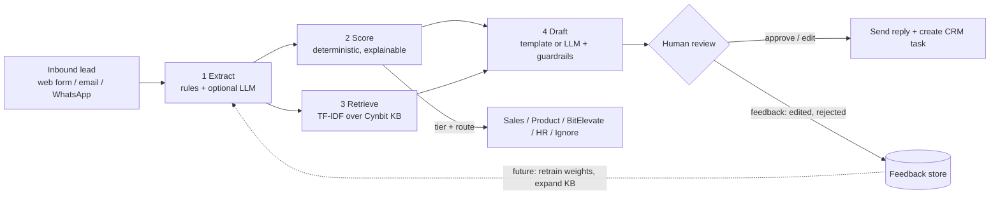
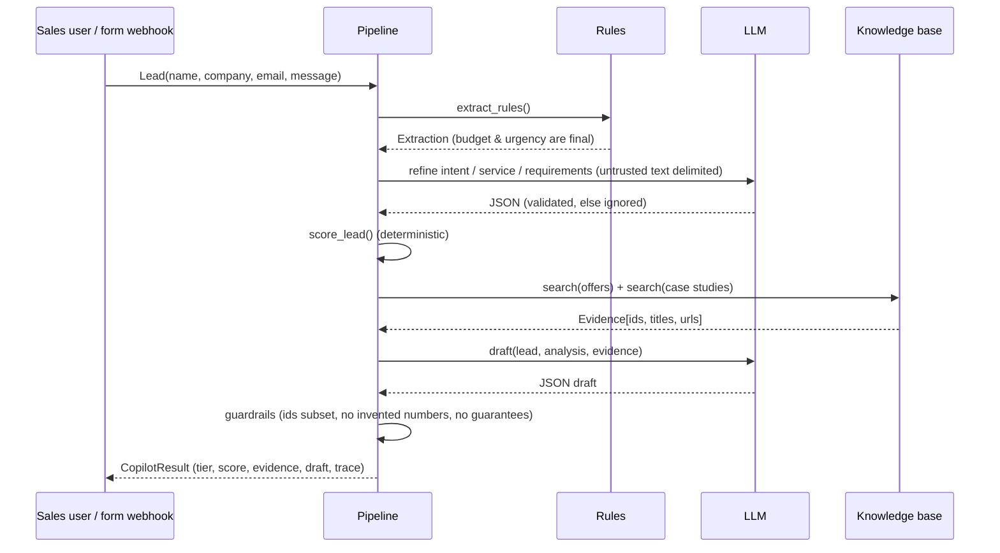

# Architecture

## 1. Logical pipeline

**Design principle: the LLM may *interpret* and *write*, but it never *decides*.** Score, tier and routing are
computed by auditable code from extracted fields, so a prompt-injected message cannot promote itself to HOT.

## 2. Component view

| Component | File | Responsibility | Failure behaviour |
|---|---|---|---|
| Schemas | `copilot/schemas.py` | Typed contracts (Pydantic) between stages | Validation error rejected at the boundary |
| Extractor | `copilot/extract.py` | Intent, service line, budget, timeline, urgency, industry, requirements | LLM output invalid → keep rule-based result |
| Scorer | `copilot/score.py` | 0-100 score from 5 explainable components, tier, route, SLA | Pure function, no I/O |
| Knowledge base | `copilot/knowledge.py` + `data/knowledge/` | TF-IDF index of services, products, program, case studies | Empty result → generic draft |
| Drafter | `copilot/draft.py` | Template draft; optional LLM draft; guardrail validation | Any guardrail violation → template draft |
| LLM layer | `copilot/llm.py` | Provider abstraction (Anthropic, OpenAI, none) | No key / API error → offline mode |
| Orchestrator | `copilot/pipeline.py` | Runs stages, records timing trace | Stage-level isolation |
| UI / API | `app.py`, `api.py` | Streamlit demo, FastAPI `POST /v1/triage` | - |

## 3. Request sequence (LLM mode)

## 4. Deployment options

| Stage | Hosting | Notes |
|---|---|---|
| Demo (this repo) | Streamlit Community Cloud or any VM | Offline mode needs no secrets |
| Pilot | Docker container on AWS/Azure (Cynbit's existing stack) behind the website-form webhook | API key in secrets manager; log only masked PII |
| Production | Same container + CRM integration, queue for retries, feedback table in PostgreSQL | Add monitoring dashboard (tier mix, edit distance, response time) |

## 5. Data flow & privacy

- Lead text is processed in memory; logs use `mask_pii()`.
- In LLM mode lead text is sent to the chosen provider - use a provider/plan with no-training terms and disclose it in the privacy policy.
- The knowledge base contains only public website content.
